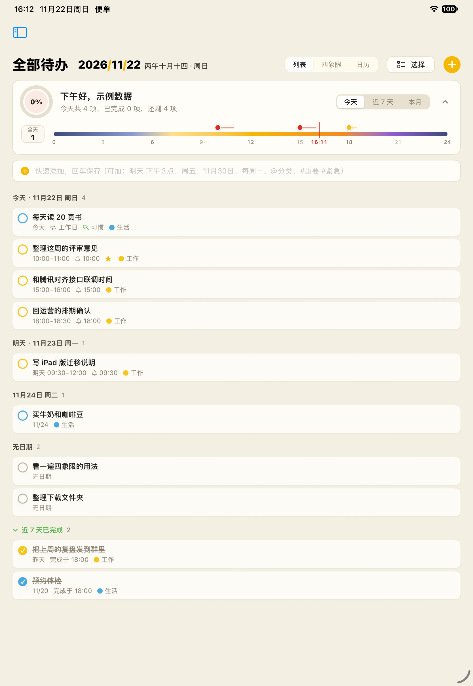
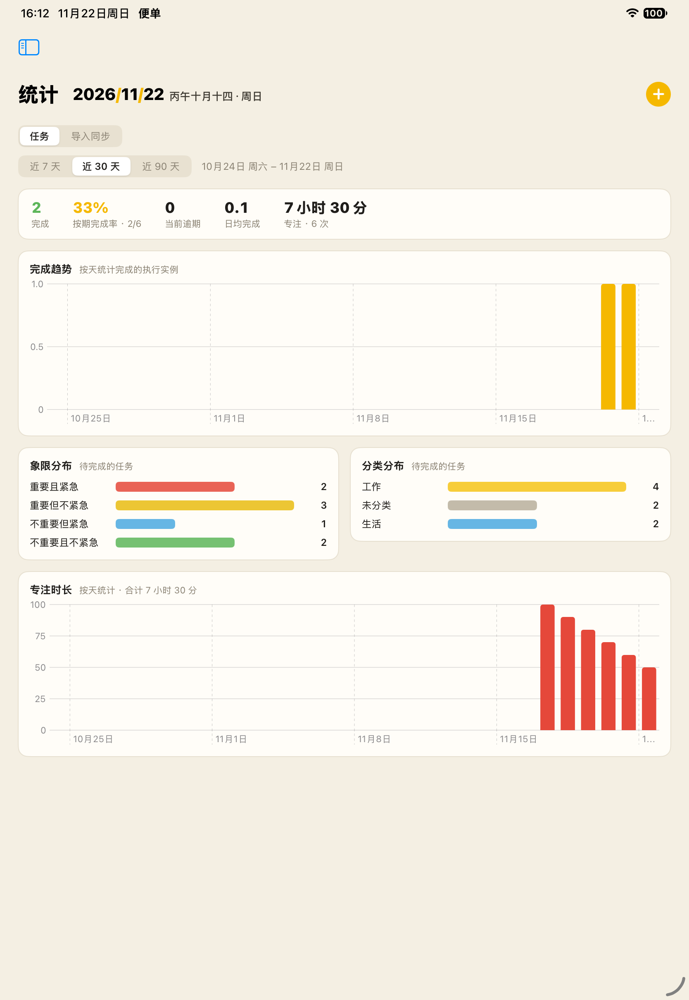

# 便单 iPadOS

将 [便单](https://github.com/yingcaihuang/biandan_MCP-main) 的 macOS 第三方客户端
移植到 iPad 的实验版本。登录、云端同步、四象限、重复规则、离线队列、本机 MCP 全部沿用上游同一份代码。

`iPadOS 17+` · `SwiftUI` · `Swift 5.9` · `仅 iPad` · 状态：**实验性**


需要用户自行侧载安装
见 [已知限制](#已知限制)。想先看界面，用下面说的示例数据模式。

## 目录

- [功能状态](#功能状态)
- [截图](#截图)
- [环境要求](#环境要求)
- [快速开始](#快速开始)
- [没有华为账号也能看界面](#没有华为账号也能看界面)
- [移植是怎么做的](#移植是怎么做的)
- [改动清单](#改动清单)
- [已知限制](#已知限制)
- [目录结构](#目录结构)
- [参与贡献](#参与贡献)
- [致谢与许可](#致谢与许可)

## 功能状态

**已移植**（业务代码与上游一致）

| 模块 | 说明 |
|---|---|
| 四象限 / 列表 / 日历 | 今日重点、按天分组、月视图（含农历、任务 chip） |
| 任务编辑 | 检查器：标题、备注、象限、待办单、时间、重复规则、收藏 |
| 云端同步 | 华为账号 OAuth（PKCE）、首同步、自动同步、冲突合并 |
| 离线队列 | 断网时写入 outbox，恢复后按序重放，设置页可看明细 |
| 统计 | 完成率、专注记录，Swift Charts |
| 提醒 | `UserNotifications` 本地通知，通知上可直接完成 |
| 导入 / 导出 | `.ics` 导入（含系统日历）、JSON / Markdown / CSV 导出（走系统分享面板） |
| 本机 MCP | `Network.framework` 实现的 HTTP MCP 服务，App 在前台时监听 |

**未移植**（iPadOS 上没有对应能力，见 [`Pad/CompatShims.swift`](Sources/BiandanPad/Pad/CompatShims.swift) 的空实现）

| 项 | 原因 |
|---|---|
| 桌面浮窗球、菜单栏组件、全局快捷键 | iPadOS 无对应概念 |
| 屏幕框选识别日程 | `ScreenCaptureKit` / 辅助功能在 iOS 上不存在 |
| 端上 `FoundationModels` 抽取 | 上游用的是 macOS 26 的模型，iOS 侧未适配 |
| 主窗口键盘监听、导览浮层 | 触屏场景下不是必需 |
| macOS 设置窗口（62KB） | 重写成了 iPad 弹层版本，功能是子集 |

## 截图

| | |
|---|---|
|  |  |
|  |  |

以上都是 iPad Pro 11 英寸（M5，iPadOS 27.2）模拟器实拍。

## 环境要求

- macOS + Xcode 27（本仓库在 Xcode 27.2 / Swift 6.4.2 上验证；Xcode 15 以上、Swift 5.9 工具链应该也可以，未验证）
- iPadOS 17.0+
- 依赖只有 [GRDB.swift](https://github.com/groue/GRDB.swift)（v6.29.3 起），SwiftPM 自动拉取
- 网络到不了 GitHub 时，把 GRDB 克隆到同级目录后带 `BIANDAN_VENDOR_GRDB=1` 构建（见下）

## 快速开始

### 1. 在模拟器里跑

```bash
git clone https://github.com/<you>/biandan-pad.git
cd biandan-pad

# 编译 + 组装 .app（iOS 模拟器 arm64）
Tools/build_pad_app.sh

# 启一台 iPad 模拟器，装上并带示例数据启动
xcrun simctl boot "iPad Pro 11-inch (M5)"
xcrun simctl install booted build/BiandanPad.app
SIMCTL_CHILD_BIANDAN_PAD_DEMO=1 xcrun simctl launch booted ai.racore.BiandanPad
```

排查用的启动开关：

| 环境变量 | 作用 |
|---|---|
| `BIANDAN_PAD_DEMO=1` | 示例数据模式：不读钥匙串、不联网，直接进主界面 |
| `BIANDAN_PAD_VIEW=list\|today\|quadrant\|calendar\|stats\|habits\|focus\|conflicts` | 启动时切到指定页面 |
| `BIANDAN_PAD_SHEET=settings` | 启动时弹出设置面板 |

### 2. 打 `.ipa` 自签安装

```bash
Tools/package_ipa.sh
# 换成自己证书能用的 bundle id / 版本号
BIANDAN_BUNDLE_ID=com.yourname.biandan BIANDAN_BUILD=2 Tools/package_ipa.sh
# 产物：dist/BiandanPad-0.1.0.ipa
```

脚本用真机 SDK（`arm64-apple-ios17.0`）编译、`actool` 生成图标、写 Info.plist、做 **ad-hoc 签名**，
所以产物不能直接安装，需要用 Sideloadly / AltStore / ESign / 爱思助手用它重签，或用 TrollStore 直接装。

### 3. 离线构建（可选）

```bash
git clone --depth 1 --branch v6.29.3 https://github.com/groue/GRDB.swift.git ../vendor/GRDB.swift
# Tools 里的脚本会自动带上 BIANDAN_VENDOR_GRDB=1
```

> 踩坑记录：iOS **模拟器**目标的交叉编译用 `--destination`（脚本里已生成），必须加 `--disable-sandbox`，
> 否则 SwiftPM 起的 `sandbox-exec` 会报 `Operation not permitted`。**真机**目标不能用 `--destination`——
> 这套工具链的 SwiftPM 会把里面的 `arm64-apple-ios17.0` 静默忽略、退回宿主 macOS 目标
> （症状是报 `onContinuousHover` 只在 macOS 14 可用），必须用 `--triple arm64-apple-ios17.0 --sdk <iPhoneOS SDK>`。

## 没有华为账号也能看界面

登录页有一个「先随便看看（载入示例数据）」的按钮：按云端记录格式往本机库写几条示例任务，走的是和同步
完全相同的落库路径（`LocalStore.apply`），不联网、不写钥匙串。选择会记住，下次启动直接进主界面；
在「设置 → 账户 → 退出示例模式」里可以退回登录页（示例数据会留在本机库里，不会被删）。

## 移植是怎么做的

原则：**业务代码不动，平台差异集中到少数几个文件**，这样上游继续更新时合并成本低。

上游的分层很干净，`import AppKit` 只出现在 UI 和系统集成层：

| 层 | 文件数 | AppKit | 处理 |
|---|---|---|---|
| `Core/`（编解码、模型、重复规则、农历） | 8 | 0 | 原样复用 |
| `Store/`（GRDB 本地库、快照、乐观更新） | 3 | 0 | 原样复用 |
| `Sync/` `Cloud/`（云端读写、outbox、节流、冲突合并） | 12 | 0 | 原样复用 |
| `MCP/`（本机 HTTP 服务） | 7 | 0 | 原样复用（`~/.biandan-mcp` 改到文稿目录） |
| `Auth/`（PKCE、令牌、续期、回调页） | 5 | 1 处 | 换掉「打开浏览器」那一行 |
| `Capture/`（AI 识别、决策、解析） | 9 | 0 | 复用解析逻辑，删掉屏幕抓取与浮窗 |
| `Views/` `App/`（界面与状态） | 90+ | 33 个文件 | 大部分复用，逐处替换 macOS API |

`AppModel`（835 行，装着全部业务状态）只有 2 行 AppKit：`NSApp.activate` 和 `NSWorkspace.open`。

### 1. 平台能力收口到 `Pad/Platform.swift`

`NSWorkspace` / `NSPasteboard` / `NSSound` / `NSColor` / `NSEvent` 在两端语义一样、API 不同，
统一改成 `Platform.open` / `.copy` / `.playDoneSound` / `.sRGB` / `HardwareKeys.shiftDown`，
调用点从 20 多处收敛到一处判断。

### 2. macOS 专有组件给「等价空实现」

`Pad/CompatShims.swift` 为 iPad 补上上游存在、iPad 上没有对应物的类型：`FloatingBallController`、
`MenuBarDefaults`、`QuickAddHotKey`、`SettingsAnchor`、`tourAnchor`。**签名不变、行为为空**，
所以 `AppModel` 和视图一行都不用改。

### 3. 登录：把浏览器搬进 App

macOS 版是「App 开系统浏览器 → 官网中转 → 回调到 `127.0.0.1:42681`」。iPadOS 上切到 Safari 后
本进程会被挂起，回环监听收不到回调。所以 PKCE、回环监听、进度页（`AuthCallbackPage`）全部原样保留，
只把「打开浏览器」换成 App 内弹 `WKWebView`（`Pad/PadAuthWebView.swift`），
授权页 → 官网中转 → 回调页全在同一个进程里走完。

### 4. 触屏替代右键

上游右键菜单是 `NSEvent` 监听 + `NSView` 命中测试（`ThemedContextMenu.swift`，21KB）。iPad 版只重写
「怎么弹」：长按 0.35 秒 → `.popover`；面板组件、分组、配色、`OccurrenceContextMenu` 里的业务动作一字未动。

### 5. 三栏按宽度自适应

竖屏 iPad（834pt）塞不下「侧栏 210 + 内容 + 检查器 320」。`Pad/PadShell.swift` 按宽度切换：≥1024pt
用常驻右栏，否则改成弹出的 sheet；标题栏用 `ViewThatFits` 在放不下时隐去农历，分段控件在窄屏用短标题。

### 6. 设置窗口 → 弹层

macOS 的 `SettingsView.swift` 有 62KB。iPad 版重写了精简面板（`Pad/PadSettingsView.swift`）：
账户 / 同步（含 outbox 明细）/ 提醒 / 数据 / MCP / 关于。视觉仍按上游 `DESIGN.md`：米色底、白卡片、
黄色强调，不用系统蓝。

## 改动清单

- **新增 10 个文件**（`Sources/BiandanPad/Pad/`）：入口与根视图、平台收口、兼容垫片、长按菜单、
  登录面板、设置面板、示例数据、引导替身
- **修改 26 个上游文件**，都是小改：
  - `import AppKit` → `#if os(macOS)`；
  - `NSSavePanel` / `NSOpenPanel` → 写文稿目录 + 系统分享面板 / `.fileImporter`；
  - `.toggleStyle(.checkbox)`、`.buttonStyle(.link)`、`.onDeleteCommand`、`#available(macOS 26)` →
    条件分支或主题化替代；
  - `FileManager.homeDirectoryForCurrentUser` → 文稿目录
- **未移植 22 个文件**：浮窗球与屏幕框选、`FoundationModels` 抽取、菜单栏、全局快捷键、键盘监听、
  导览浮层、AI 用量页、macOS 设置窗口

## 已知限制

| 项 | 情况 |
|---|---|
| 华为登录 | 未用真实账号跑通。`WKWebView` 里走的是官网中转 + 本机回环，逻辑与原版一致，但授权页对 WebView 的兼容性需要真机确认 |
| 真机安装 | `.ipa` 是 ad-hoc 签名，没有在真 iPad 上装过；重签后能否启动取决于你的证书/描述文件，Keychain（登录态）在自签环境下也可能因 entitlements 不全而失败 |
| 横屏 / 分屏 | 模拟器无法用命令行旋转，横屏路径（检查器常驻栏）未截图验证，代码与 macOS 版一致 |
| 通知与提醒 | 已接 `UserNotifications`，未做真机投递验证；通知上的「完成 / 10 分钟后提醒」依赖通知 action，需要正式签名的包才有意义 |
| 本机 MCP | 只能前台监听，iPadOS 不允许后台长驻；配置里的地址要换成 iPad 的局域网 IP |
| 触屏拖拽 | 卡片拖到象限/侧栏/日历的 `.dropDestination` 代码保留，未做触摸拖拽验证 |

## 目录结构

```
.
├── Package.swift                  iOS 17+，依赖 GRDB（默认远程，可切本地 vendor）
├── Sources/BiandanPad/
│   ├── Core/ Store/ Sync/ Cloud/ MCP/ Auth/ Capture/ Import/   ← 上游代码，少量条件编译
│   ├── App/ Views/                                             ← 上游界面，少量条件分支
│   └── Pad/                                                    ← 新增：iPad 外壳与平台适配
├── Tools/
│   ├── build_pad_app.sh           编译 + 组装 .app（模拟器）
│   └── package_ipa.sh             编译 + 打包 .ipa（真机，自签用）
├── docs/
│   ├── screenshots/               模拟器实拍
│   └── AppIcon-1024.png           图标源图
├── NOTICE.md                      来源、版权与许可说明
└── README.md
```

## 参与贡献

作者原话是「开源出来大家一起改」，所以 PR / issue 都欢迎。有两条约定能让合并省事：

1. **优先只改 `Sources/BiandanPad/Pad/`**。上游文件能不动就不动；非动不可时用 `#if os(iOS)` / `#if os(macOS)`
   切分支，而不是直接改掉 macOS 的行为——这样上游更新才能合进来。
2. **别引入第三方 UI 库**。现在只有 GRDB 一个依赖，主题色和组件都沿用上游 `ThemeKit` 那套。

上游还在持续开发，跟进的流程大致是：

```bash
# 1. 拉上游最新源码（稀疏检出，只取代码目录）
git clone --depth 1 --filter=blob:none --sparse \
  https://github.com/yingcaihuang/biandan_MCP-main /tmp/up
cd /tmp/up && git sparse-checkout set BiandanMac/Sources && git checkout

# 2. 只做对比，别整目录覆盖——那会把未移植的 22 个 macOS 文件带回来
diff -rq /tmp/up/BiandanMac/Sources/BiandanMac Sources/BiandanPad | grep -v '/Pad/'

# 3. 逐个把改动合进来，跑一遍编译
Tools/build_pad_app.sh
```

提 issue 时带上这些信息，省一轮来回：iPad 机型 + iPadOS 版本、是否自签安装、复现步骤，
以及是否开了 `BIANDAN_PAD_DEMO` 之类的开关。

## 致谢与许可

- 全部业务逻辑与界面设计来自 [yingcaihuang/biandan_MCP-main](https://github.com/yingcaihuang/biandan_MCP-main) 的
  `BiandanMac/`，这里只做了平台移植。**没有上游那份代码，这个仓库不存在。**
- macOS 端作者 **贝奇小天狼星** 在便单交流群里对这个移植的态度是鼓励的：

  > 「开源出来大家一起改。多好😁，这样大部分人都还可以改成适配 iOS 的。」

  他也说明了 iOS / iPad 目前只是自己的备用平台，主用是 macOS 和华为，所以没打算自己动手做 iOS 版。
- 便单开发团队（群主）也表示想把这个仓库挂到官方仓库文档里。
- **上游仓库本身没有 LICENSE 文件**，所以本仓库也不单独声明许可证、不构成对上游代码的再授权；
  商用或把这份代码再分发到别的产品，仍建议先和作者确认。详见 [NOTICE.md](NOTICE.md)。
- 本仓库是社区移植，与华为、与便单官方没有隶属关系；「便单」名称与图标权利归原作者所有。

## 如果继续做下去

1. **真机跑通登录**：确认 `WKWebView` 能走完华为授权，否则换 `ASWebAuthenticationSession` + 自定义 scheme
2. **横屏与 Stage Manager**：`columnVisibility` 按宽度收敛，补分屏布局
3. **触屏拖拽**：拖到象限 / 拖到日历是这套 UI 的核心交互，触屏要用长按拖拽
4. **相机 / 相册识别日程**：把屏幕框选换成 Vision + 相册，`SchedulePreview` 换成触屏确认卡片
5. **键盘与 Apple Pencil**：iPad 用户接键盘比例高，上游那套键盘导航值得搬回来
