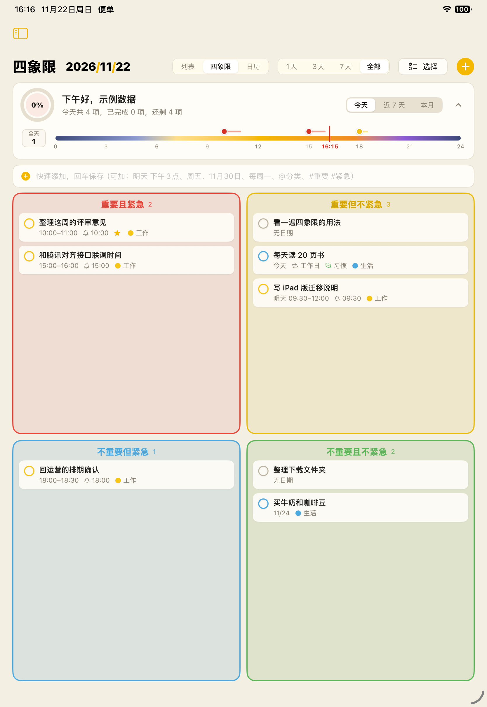
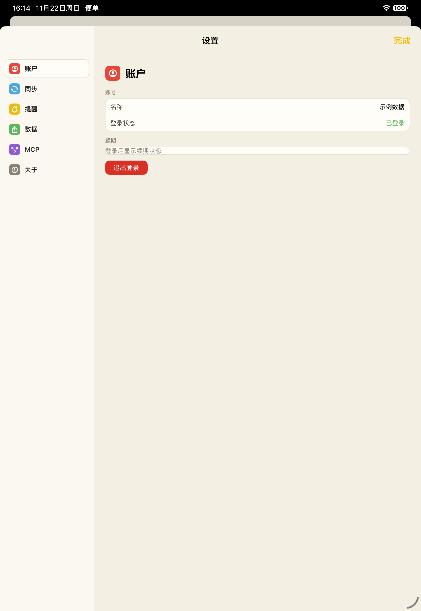

# 便单 iPadOS

本项目将[便单](https://github.com/yingcaihuang/biandan_MCP-main)的 macOS 第三方客户端移植至 iPad，形成第三方实验性版本。登录、云端同步、四象限、重复规则、离线队列、本机 MCP 等功能均沿用上游实现。

`iPadOS 17+` · `SwiftUI` · `Swift 5.9` · `仅支持 iPad` · 状态：**实验性**



> 本应用须由用户自行签名并侧载安装，详见[已知限制](#已知限制)。

## 目录

- [功能状态](#功能状态)
- [截图](#截图)
- [环境要求](#环境要求)
- [快速开始](#快速开始)
- [无华为账号时的界面预览](#无华为账号时的界面预览)
- [移植方案](#移植方案)
- [改动清单](#改动清单)
- [已知限制](#已知限制)
- [目录结构](#目录结构)
- [参与贡献](#参与贡献)
- [致谢与许可](#致谢与许可)

## 功能状态

**已移植模块**（业务代码与上游保持一致）

| 模块            | 说明                                                 |
| ------------- | -------------------------------------------------- |
| 四象限 / 列表 / 日历 | 今日重点、按天分组、月视图（含农历、任务 chip）                         |
| 任务编辑          | 检查器：标题、备注、象限、待办单、时间、重复规则、收藏                        |
| 云端同步          | 华为账号 OAuth（PKCE）、首次同步、自动同步、冲突合并                    |
| 离线队列          | 断网时写入 outbox，恢复联网后按序重放，设置页可查看明细                    |
| 统计            | 完成率、专注记录，基于 Swift Charts                           |
| 提醒            | `UserNotifications` 本地通知，支持在通知上直接完成任务              |
| 导入 / 导出       | `.ics` 导入（含系统日历），JSON / Markdown / CSV 导出（经系统分享面板） |
| 本机 MCP        | 基于 `Network.framework` 的 HTTP MCP 服务，应用位于前台时监听     |

**未移植模块**（iPadOS 缺乏对应平台能力，相关实现见 [`Pad/CompatShims.swift`](Sources/BiandanPad/Pad/CompatShims.swift) 的空实现）

| 项                        | 原因                                 |
| ------------------------ | ---------------------------------- |
| 桌面浮窗球、菜单栏组件、全局快捷键        | iPadOS 无对应平台概念                     |
| 屏幕框选识别日程                 | `ScreenCaptureKit` 与辅助功能在 iOS 上不可用 |
| 端上 `FoundationModels` 抽取 | 上游依赖 macOS 26 的模型，iOS 侧尚未适配        |
| 主窗口键盘监听、导览浮层             | 触屏交互场景下非必需                         |
| macOS 设置窗口（62 KB）        | 已重写为 iPad 弹层版本，功能为原实现的子集           |

## 截图

模拟器截图取自 iPad Pro 11 英寸（M5，iPadOS 27.2）；登录、四象限、列表、日历、统计与设置如下。



## 环境要求

- macOS 与 Xcode 27。本仓库已在 Xcode 27.2 / Swift 6.4.2 环境下验证；理论上兼容 Xcode 15 及以上版本与 Swift 5.9 工具链，但尚未验证。
- iPadOS 17.0 及以上版本。
- 唯一第三方依赖为 [GRDB.swift](https://github.com/groue/GRDB.swift)（v6.29.3 起），由 SwiftPM 自动拉取。
- 若网络无法访问 GitHub，可将 GRDB 克隆至同级目录，并通过 `BIANDAN_VENDOR_GRDB=1` 进行离线构建（详见下文）。

## 快速开始

### 1. 在模拟器中运行

```bash
git clone https://github.com/<you>/biandan-pad.git
cd biandan-pad

# 编译并组装 .app（iOS 模拟器 arm64）
Tools/build_pad_app.sh

# 启动一台 iPad 模拟器，安装应用并以示例数据启动
xcrun simctl boot "iPad Pro 11-inch (M5)"
xcrun simctl install booted build/BiandanPad.app
SIMCTL_CHILD_BIANDAN_PAD_DEMO=1 xcrun simctl launch booted ai.racore.BiandanPad
```

调试用启动开关：

| 环境变量                                                                                | 作用                       |
| ----------------------------------------------------------------------------------- | ------------------------ |
| `BIANDAN_PAD_DEMO=1`                                                                | 示例数据模式：不读钥匙串、不联网，直接进入主界面 |
| `BIANDAN_PAD_VIEW=list\|today\|quadrant\|calendar\|stats\|habits\|focus\|conflicts` | 启动时切换至指定页面               |
| `BIANDAN_PAD_SHEET=settings`                                                        | 启动时弹出设置面板                |

### 2. 打包 `.ipa` 用于自签名安装

```bash
Tools/package_ipa.sh
# 替换为个人证书可用的 bundle id 与版本号
BIANDAN_BUNDLE_ID=com.yourname.biandan BIANDAN_BUILD=2 Tools/package_ipa.sh
# 产物：dist/BiandanPad-0.1.0.ipa
```

该脚本使用真机 SDK（`arm64-apple-ios17.0`）编译，通过 `actool` 生成图标、写入 Info.plist，并执行 **ad-hoc 签名**。因此产物无法直接安装，须借助 Sideloadly、AltStore、ESign 或爱思助手重新签名，或使用 TrollStore 直接安装。

### 3. 离线构建（可选）

```bash
git clone --depth 1 --branch v6.29.3 https://github.com/groue/GRDB.swift.git ../vendor/GRDB.swift
# Tools 目录下的脚本会自动带上 BIANDAN_VENDOR_GRDB=1
```

> **构建注意事项**：iOS **模拟器**目标的交叉编译使用 `--destination`（脚本中已生成），且必须附加 `--disable-sandbox`，否则 SwiftPM 启动的 `sandbox-exec` 会报 `Operation not permitted`。**真机**目标则不可使用 `--destination`：当前工具链的 SwiftPM 会静默忽略其中的 `arm64-apple-ios17.0`，回退至宿主 macOS 目标（表现为提示 `onContinuousHover` 仅在 macOS 14 可用），此时须改用 `--triple arm64-apple-ios17.0 --sdk <iPhoneOS SDK>`。

## 无华为账号时的界面预览

登录页提供「先随便看看（载入示例数据）」入口：按云端记录的格式向本机数据库写入若干示例任务，其落库路径与同步流程完全一致（`LocalStore.apply`），且不联网、不写入钥匙串。该选择会被记录，后续启动直接进入主界面；在「设置 → 账户 → 退出示例模式」中可返回登录页（示例数据仍保留在本机数据库中，不会删除）。

## 移植方案

移植原则为：**不改动业务代码，将平台差异集中于少数文件**，以降低上游持续更新时的合并成本。

上游代码分层清晰，`import AppKit` 仅出现于 UI 与系统集成层：

| 层                                     | 文件数 | AppKit | 处理                            |
| ------------------------------------- | --- | ------ | ----------------------------- |
| `Core/`（编解码、模型、重复规则、农历）               | 8   | 0      | 原样复用                          |
| `Store/`（GRDB 本地库、快照、乐观更新）            | 3   | 0      | 原样复用                          |
| `Sync/` `Cloud/`（云端读写、outbox、节流、冲突合并） | 12  | 0      | 原样复用                          |
| `MCP/`（本机 HTTP 服务）                    | 7   | 0      | 原样复用（`~/.biandan-mcp` 改至文稿目录） |
| `Auth/`（PKCE、令牌、续期、回调页）               | 5   | 1 处    | 仅替换「打开浏览器」一处实现                |
| `Capture/`（AI 识别、决策、解析）               | 9   | 0      | 复用解析逻辑，移除屏幕抓取与浮窗              |
| `Views/` `App/`（界面与状态）                | 90+ | 33 个文件 | 大部分复用，逐处替换 macOS API          |

`AppModel`（835 行，承载全部业务状态）中仅有 2 行 AppKit 代码：`NSApp.activate` 与 `NSWorkspace.open`。

### 1. 平台能力统一收口至 `Pad/Platform.swift`

`NSWorkspace` / `NSPasteboard` / `NSSound` / `NSColor` / `NSEvent` 在两个平台上语义一致而 API 不同，现统一收敛为 `Platform.open` / `.copy` / `.playDoneSound` / `.sRGB` / `HardwareKeys.shiftDown`，使 20 余处调用点归并为单一判断。

### 2. 为 macOS 专有组件提供等价空实现

`Pad/CompatShims.swift` 为 iPad 补齐上游存在、而 iPad 上无对应物的类型：`FloatingBallController`、`MenuBarDefaults`、`QuickAddHotKey`、`SettingsAnchor`、`tourAnchor`。其**接口签名保持不变，行为为空实现**，因此 `AppModel` 与各视图均无需修改。

### 3. 登录流程：由外部浏览器改为应用内嵌浏览器

macOS 版的流程为「应用唤起系统浏览器 → 官网中转 → 回调至 `127.0.0.1:42681`」。在 iPadOS 上切换至 Safari 后，本进程会被挂起，回环监听无法收到回调。因此 PKCE、回环监听与进度页（`AuthCallbackPage`）全部原样保留，仅将「打开浏览器」改为应用内弹出 `WKWebView`（`Pad/PadAuthWebView.swift`），使授权页 → 官网中转 → 回调页在同一进程内完成。

### 4. 以长按手势替代右键菜单

上游的右键菜单基于 `NSEvent` 监听与 `NSView` 命中测试实现（`ThemedContextMenu.swift`，21 KB）。iPad 版仅重写触发方式：长按 0.35 秒弹出 `.popover`；面板组件、分组、配色以及 `OccurrenceContextMenu` 中的业务动作均未改动。

### 5. 三栏布局按宽度自适应

竖屏 iPad（834 pt）无法容纳「侧栏 210 pt + 内容区 + 检查器 320 pt」的三栏布局。`Pad/PadShell.swift` 依据宽度切换：宽度 ≥ 1024 pt 时使用常驻右栏，否则改为弹出式 sheet；标题栏通过 `ViewThatFits` 在空间不足时隐去农历，分段控件在窄屏下改用短标题。

### 6. 设置窗口改为弹层面板

macOS 版 `SettingsView.swift` 体积为 62 KB。iPad 版重写为精简面板（`Pad/PadSettingsView.swift`），包含账户、同步（含 outbox 明细）、提醒、数据、MCP、关于六个部分。视觉仍遵循上游 `DESIGN.md`：米色背景、白色卡片、黄色强调色，不使用系统蓝。

## 改动清单

- **新增 10 个文件**（`Sources/BiandanPad/Pad/`）：入口与根视图、平台收口、兼容垫片、长按菜单、登录面板、设置面板、示例数据、引导替身。
- **修改 26 个上游文件**，改动均为局部调整：
  - `import AppKit` 改为 `#if os(macOS)`；
  - `NSSavePanel` / `NSOpenPanel` 改为写入文稿目录并调用系统分享面板 / `.fileImporter`；
  - `.toggleStyle(.checkbox)`、`.buttonStyle(.link)`、`.onDeleteCommand`、`#available(macOS 26)` 改为条件分支或主题化替代实现；
  - `FileManager.homeDirectoryForCurrentUser` 改为文稿目录。
- **未移植 22 个文件**：浮窗球与屏幕框选、`FoundationModels` 抽取、菜单栏、全局快捷键、键盘监听、导览浮层、AI 用量页、macOS 设置窗口。

## 已知限制

| 项       | 情况                                                                                                    |
| ------- | ----------------------------------------------------------------------------------------------------- |
| 华为登录    | 在运行iPadOS 18.7.8的iPad Air（第5代）上可用。`WKWebView` 内采用官网中转与本地回环，逻辑与原版一致。                                   |
| 真机安装    | `.ipa` 为 ad-hoc 签名；重签名后能否启动取决于所用证书与描述文件，且自签名环境下 Keychain（登录态）可能因 entitlements 不完整而失败 |
| 横屏 / 分屏 | 侧拉和长条形窄窗口暂不支持                                                       |
| 通知与提醒   | 已接入 `UserNotifications`；通知上的「完成 / 10 分钟后提醒」依赖通知 action，需正式签名的安装包方可生效                        |
| 本机 MCP  | 仅支持前台监听，iPadOS 不允许后台常驻；配置中的地址需替换为 iPad 的局域网 IP                                                        |
| 触屏拖拽    | 卡片拖拽至象限 / 侧栏 / 日历的 `.dropDestination` 代码已保留，                                               |

## 目录结构

```
.
├── Package.swift                  iOS 17+，依赖 GRDB（默认远程，可切换本地 vendor）
├── Sources/BiandanPad/
│   ├── Core/ Store/ Sync/ Cloud/ MCP/ Auth/ Capture/ Import/   ← 上游代码，少量条件编译
│   ├── App/ Views/                                             ← 上游界面，少量条件分支
│   └── Pad/                                                    ← 新增：iPad 外壳与平台适配
├── Tools/
│   ├── build_pad_app.sh           编译并组装 .app（模拟器）
│   └── package_ipa.sh             编译并打包 .ipa（真机，自签名用）
├── docs/
│   ├── screenshots/               模拟器实拍截图
│   └── AppIcon-1024.png           图标源图
├── NOTICE.md                      来源、版权与许可说明
└── README.md
```

## 参与贡献

欢迎提交 Pull Request 或 Issue。

## 致谢与许可

- 全部业务逻辑与界面设计均来自 [yingcaihuang/biandan\_MCP-main](https://github.com/yingcaihuang/biandan_MCP-main) 的 `BiandanMac/`，本仓库仅负责平台移植。若无上游代码，本仓库将无从谈起。
- **上游仓库未提供 LICENSE 文件**，因此本仓库亦不单独声明许可证，且不构成对上游代码的再授权；如需商用或将本代码再分发至其他产品，建议先与原作者确认。详见 [NOTICE.md](NOTICE.md)。
- 本仓库为社区移植项目，与华为及便单官方均无隶属关系；「便单」名称与图标的相关权利归原作者所有。
